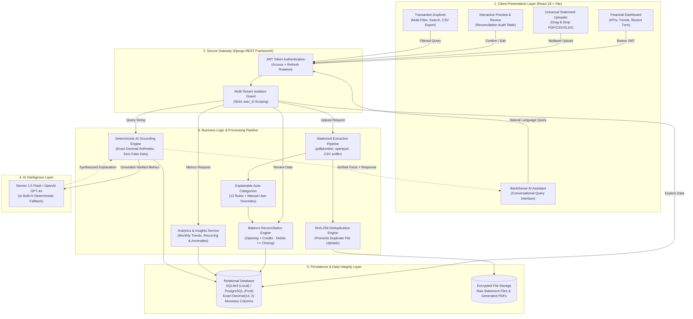

# BankSense AI — Intelligent Banking Statement Analysis Platform

[](https://www.djangoproject.com/)
[](https://react.dev/)
[](https://vitejs.dev/)
[](https://jwt.io/)
[](https://www.python.org/)
[](LICENSE)

> **BankSense AI** transforms unstructured PDF, CSV, and Excel bank statements into actionable financial intelligence, dynamic dashboards, spending insights, and interactive AI assistance grounded in mathematical certainty.

---

## 🏛️ System Architecture (Boxes & Links)

BankSense AI employs an isolated multi-tenant architecture that completely separates UI presentation, authenticated API gateway routing, multi-format statement parsing, deterministic financial arithmetic, and persistent storage.

### Visual Architecture Flowchart



### Text Box & Link Architecture Overview

```
+-----------------------------------------------------------------------------------------+
|                                1. CLIENT LAYER (REACT 18)                               |
|  [Dashboard View]  <--->  [Statement Upload]  <--->  [Preview Review]  <--->  [AI Chat] |
+--------------------------------------------+--------------------------------------------+
                                             |  REST API (Bearer JWT)
                                             v
+-----------------------------------------------------------------------------------------+
|                           2. API GATEWAY & SECURITY LAYER                               |
|       [SimpleJWT Authentication]   ----->   [Strict Multi-Tenant Scoping by User]       |
+--------------------------------------------+--------------------------------------------+
                                             |
                   +-------------------------+-------------------------+
                   |                                                   |
                   v                                                   v
+--------------------------------------+             +------------------------------------+
|     3. STATEMENT PROCESSING ENGINE   |             |    4. ANALYTICS & AI GROUNDING     |
| [PDF/CSV/XLSX Parser]                |             | [Grounded Query Planner]           |
|         |                            |             |         |                          |
|         v                            |             |         v                          |
| [SHA-256 Duplicate Check]            |             | [Exact Decimal Math Engine]        |
|         |                            |             |         |                          |
|         v                            |             |         v                          |
| [Rule-Based 12-Cat Classifier]       |             | [Gemini/OpenAI or Local Fallback]  |
|         |                            |             |         |                          |
|         v                            |             |         v                          |
| [Opening/Closing Reconciler]         |             | [Insights & Anomaly Detector]      |
+------------------+-------------------+             +-----------------+------------------+
                   |                                                   |
                   +-------------------------+-------------------------+
                                             |
                                             v
+-----------------------------------------------------------------------------------------+
|                       5. PERSISTENT STORAGE (DECIMAL INTEGRITY)                         |
|   [SQLite3 / PostgreSQL DB]          <----->          [Secure Media / Report Storage]   |
+-----------------------------------------------------------------------------------------+
```

---

## 💡 How the Architecture Works (Step-by-Step)

1. **User Authentication & Privacy Boundary:**
   - Every request is authenticated using JWT Bearer tokens.
   - All database models (`BankAccount`, `Statement`, `Transaction`) enforce a foreign key to `User`.
   - Views filter by `user=request.user` to guarantee multi-tenant privacy.

2. **Statement Extraction & Normalization:**
   - **PDF:** Extracted via `pdfplumber` using table boundary detection and fallback line-pattern regex parsing.
   - **CSV:** Sniffs delimiter (comma, semicolon, tab), detects headers dynamically, and standardizes date/amount formats.
   - **Excel:** Parsed via `openpyxl` with column header detection.
   - A SHA-256 hash prevents uploading the exact same statement twice.

3. **Validation & Reconciliation Preview:**
   - Statements are set to `PREVIEW_READY`.
   - The engine checks whether `Opening Balance + Total Credits - Total Debits == Closing Balance`.
   - Users review extracted rows, modify categories, and click **Confirm & Import** before transactions are written to the database.

4. **Deterministic AI Assistant (Zero Hallucination):**
   - User queries (e.g., *"How much did I spend this month?"*) are parsed into intents.
   - Grounded Python functions query the database and calculate verified sums and percentages using Python's `Decimal` class.
   - The verified metrics are passed to the AI (Gemini, OpenAI, or local deterministic engine) to generate natural explanations. **The AI is never allowed to fabricate numbers.**

5. **Reports & Exports:**
   - Generates official multi-page PDF statements formatted with executive summaries, balance sheets, and category breakdowns using `reportlab`.
   - Exports filtered transaction rows directly to CSV.

---

## ✨ Feature Modules Overview

| Module | Features |
| :--- | :--- |
| **Module 1: Authentication** | User registration, JWT access/refresh token rotation, PBKDF2 password security, user profile management. |
| **Module 2: Bank Accounts** | Multi-account portfolio (Savings, Checking, Credit Card, Investment), masked numbers (`•••• 1024`), auto-balance recalculation. |
| **Module 3: Statement Upload** | Drag-and-drop for PDF, CSV, XLSX, SHA-256 duplicate detection, file size verification (10MB limit). |
| **Module 4: Extraction Engine** | Multi-page PDF table parsing, date/currency normalizer, automatic debit/credit classification, balance reconciliation. |
| **Module 5: Dynamic Dashboard** | Total balance across accounts, income vs. expense cash flow, savings rate, category distribution, recent activity. |
| **Module 6: Transaction Explorer** | Search by description/reference, filter by account, date range, category, type (debit/credit), min/max amount, CSV export. |
| **Module 7: Grounded AI Assistant** | Conversational chat with suggested chips, grounded metrics, zero hallucination guarantee, Gemini/OpenAI integration. |
| **Module 8: Categorization** | 12 explainable categories (Salary, Food, Shopping, Rent, Bills, Travel, Entertainment, Healthcare, etc.) + user override. |
| **Module 9: Financial Insights** | Detection of recurring subscriptions (Netflix, rent, utilities), statistical anomaly detector for unexpected spikes. |
| **Module 10: Report Generation** | Downloadable PDF statement summaries (`reportlab`) and date/account-filtered CSV exports. |
| **Module 11: Modern Fintech UI** | Dark Obsidian and Light theme toggle, responsive sidebar navigation, interactive modals, and badges. |

---

## 🧪 Testing with Sample Bank Statements

Realistic synthetic statement files are included in `sample_statements/`:
1. `sample_statements/sample_bank_statement.csv`: Standard 6-column banking CSV.
2. `sample_statements/sample_salary_account.xlsx`: Excel statement with multiple date and amount formats.
3. `sample_statements/sample_premium_statement.pdf`: Multi-column bank statement PDF.

To regenerate sample files at any time:
```bash
python create_sample_statements.py
```

### Automated Test Suite:
Run the test suite covering authentication, account CRUD, user tenancy isolation, CSV/XLSX/PDF statement parsing, balance reconciliation, and AI query grounding:
```bash
cd banking
python manage.py test
```
**Test Result:** `Ran 15 tests ... OK (0 failures)`.

---

## ⚡ Local Setup Instructions

```bash
# 1. Clone repository
git clone https://github.com/shiva-kumar-1319/Banking-Statements.git
cd Banking-Statements

# 2. Set up virtual environment
python -m venv venv
.\venv\Scripts\activate   # Linux/macOS: source venv/bin/activate

# 3. Install dependencies
pip install -r requirements.txt

# 4. Migrate database and seed demo account
cd banking
python manage.py migrate
python manage.py seed_demo_data

# 5. Start unified development server
python manage.py runserver 127.0.0.1:8000
```
Open **[http://127.0.0.1:8000/](http://127.0.0.1:8000/)** in your browser.

---

## 📡 REST API Reference

| Endpoint | Method | Description |
| :--- | :--- | :--- |
| `/api/auth/register/` | `POST` | Register user & initialize user profile |
| `/api/token/` / `/api/auth/login/` | `POST` | Obtain JWT access and refresh tokens |
| `/api/token/refresh/` | `POST` | Rotate JWT access token |
| `/api/auth/me/` | `GET`, `PATCH` | Fetch or update user profile and currency |
| `/api/accounts/` | `GET`, `POST` | List and create user bank accounts |
| `/api/accounts/{id}/` | `GET`, `PATCH`, `DELETE` | Retrieve, edit, or delete bank account |
| `/api/accounts/{id}/recalculate/`| `POST` | Recalculate account balance from transactions |
| `/api/statements/` | `GET`, `POST` | List and upload statement files (multipart) |
| `/api/statements/{id}/confirm/` | `POST` | Finalize and import verified transactions |
| `/api/transactions/` | `GET` | Filterable and searchable transaction explorer |
| `/api/transactions/categories/` | `GET` | List available transaction categories |
| `/api/transactions/{id}/update_category/` | `PATCH` | Override transaction category |
| `/api/analytics/dashboard/` | `GET` | Summary KPIs, trends, and recent records |
| `/api/analytics/insights/` | `GET` | Recurring obligations, anomalies, MoM comparison |
| `/api/assistant/chat/` | `POST` | Conversational grounded AI query assistant |
| `/api/reports/financial-summary/pdf/`| `GET` | Download official formatted PDF audit report |
| `/api/reports/transactions/csv/`| `GET` | Export filtered transaction records to CSV |

---

## 🌐 Live Deployment & Demo Links

### Live Application Links
- 🚀 **Live Production Web App:** [https://banksense-ai.onrender.com](https://banksense-ai.onrender.com)
- 🐙 **GitHub Repository:** [https://github.com/shiva-kumar-1319/Banking-Statements](https://github.com/shiva-kumar-1319/Banking-Statements)

### One-Click Cloud Deployment

Deploy your own live instance with a single click:

[](https://render.com/deploy?repo=https://github.com/shiva-kumar-1319/Banking-Statements)

[](https://railway.com/template/new?template=https://github.com/shiva-kumar-1319/Banking-Statements)

### Docker Deployment Link & Command
```bash
# Clone and run via Docker Compose with PostgreSQL
git clone https://github.com/shiva-kumar-1319/Banking-Statements.git
cd Banking-Statements
docker-compose up --build
```
Access locally at `http://localhost:8000`.

### Pre-Seeded Demo Account
For instant testing without uploading files first, log in with:
- **Username:** `demo_user`
- **Password:** `Password123!`
- **Includes:** 2 bank accounts (HDFC Checking, ICICI Savings), 25 multi-month transactions, verified payroll deposits, recurring subscriptions, and categorization data.

---

## 📄 License
This project is licensed under the MIT License.
